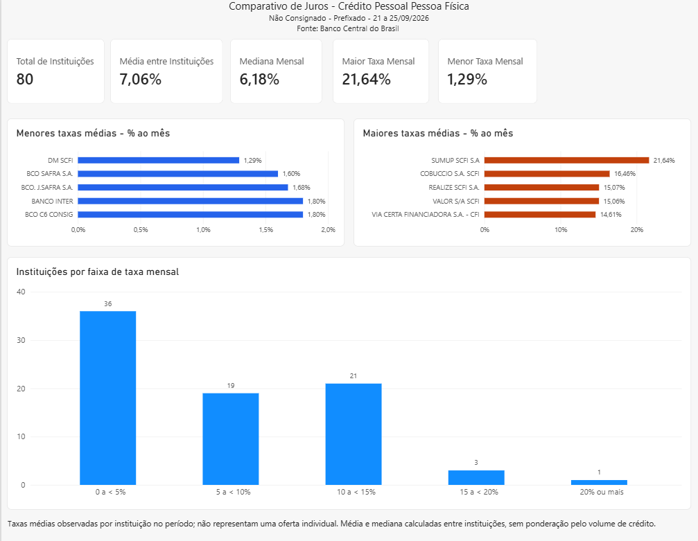

# Análise de Taxas de Crédito Pessoal para Pessoa Física

Comparação das taxas médias de juros de 80 instituições financeiras,
com dados públicos do Banco Central do Brasil.

## Objetivo

Identificar as menores e maiores taxas médias de crédito pessoal
não consignado, na modalidade prefixada, e analisar sua distribuição
entre as instituições.

## Escopo

- Público: Pessoa física.
- Modalidade: Crédito pessoal não consignado — prefixado.
- Período: 21 a 25 de setembro de 2026.
- Unidade de análise: Instituição financeira.
- Taxas analisadas: Percentuais ao mês.

## Dashboard



## Principais resultados

| Indicador | Resultado |
|---|---:|
| Instituições analisadas | 80 |
| Menor taxa média mensal | 1,29% |
| Maior taxa média mensal | 21,64% |
| Média simples entre instituições | 7,06% ao mês |
| Mediana entre instituições | 6,18% ao mês |
| Amplitude das taxas | 20,35 pontos percentuais |

Das 80 instituições analisadas, 36 (45%) apresentaram taxa média
inferior a 5% ao mês.

A menor taxa média foi observada na DM SCFI, e a maior,
na SUMUP SCFI S.A.

## Limitações

- As taxas médias observadas não garantem uma oferta individual.
- Cada instituição tem o mesmo peso na média calculada:
  não há ponderação pelo volume de crédito.
- Os percentuais de instituições não representam percentuais de clientes.
- O recorte de um único período não permite avaliar a evolução
  dos juros ao longo do tempo.

## Uso do comparativo

A análise pode servir como ponto de partida para selecionar instituições
e solicitar propostas. As taxas médias, isoladamente, não determinam
qual será a melhor oferta para uma pessoa.

## Preparação e análise dos dados

O processamento foi realizado em Python, com Pandas:

1. Leitura do CSV com separador ponto e vírgula e vírgula decimal.
2. Preservação do campo cnpj8 como texto, mantendo os zeros à esquerda.
3. Verificação de valores ausentes, duplicidades e taxas não positivas.
4. Conferência do segmento e da modalidade de crédito.
5. Inclusão das datas de referência do período.
6. Cálculo de estatísticas descritivas, rankings e distribuição por faixas.
7. Exportação da base tratada para uso no Power BI.

Nas verificações realizadas, não foram encontrados valores ausentes,
linhas duplicadas, CNPJs repetidos ou taxas não positivas.

No Power BI, foram criadas medidas para os indicadores e gráficos
de comparação entre instituições e distribuição das taxas.

## Tecnologias utilizadas

- Python 3.14.0
- pandas 3.0.6
- Power BI Desktop
- PyCharm

## Organização do projeto

| Caminho | Conteúdo |
|---|---|
| dados/historicotaxajurosdiario_TodosCampos.csv | Dados originais do Banco Central |
| dados/juros_tratados.csv | Base exportada após o tratamento |
| src/analise_juros.py | Script de tratamento e análise |
| dashboard/comparativo_juros.pbix | Relatório do Power BI |
| imagens/dashboard.png | Captura do dashboard |
| requirements.txt | Dependência Python e sua versão |
| .gitignore | Regras para arquivos não versionados |

## Como executar

Ambiente utilizado: Python 3.14.0.

1. Baixe o repositório e abra um terminal na pasta principal.
2. Crie um ambiente virtual:

   ```bash
   python -m venv .venv
   ```

3. Instale a dependência e execute a análise. No Windows:

   ```bash
   .venv\Scripts\python.exe -m pip install -r requirements.txt
   .venv\Scripts\python.exe src\analise_juros.py
   ```

O script lê o CSV original da pasta `dados`, apresenta os resultados
no terminal e gera ou substitui `dados/juros_tratados.csv`.

## Como abrir o dashboard

Abra `dashboard/comparativo_juros.pbix` no Power BI Desktop.

Para atualizar os dados em outro computador, ajuste o caminho da fonte
da consulta `juros_tratados` para o arquivo `dados/juros_tratados.csv`
na sua cópia do projeto e aplique as alterações.

## Fonte dos dados

Banco Central do Brasil — consulta de taxas de juros por instituição.

- Segmento: Pessoa física.
- Modalidade: Crédito pessoal não consignado — prefixado.
- Período analisado: 21 a 25 de setembro de 2026.
- Formato de origem: CSV.

A página de consulta pode apresentar um período mais recente ao ser
aberta. Os resultados deste projeto correspondem ao período acima,
preservado no arquivo original da pasta `dados`.

[Banco Central do Brasil — consulta de taxas de juros por instituição](https://www.bcb.gov.br/estatisticas/reporttxjuros?codigoSegmento=1&codigoModalidade=221101&tipoModalidade=D&InicioPeriodo=2026-09-25)